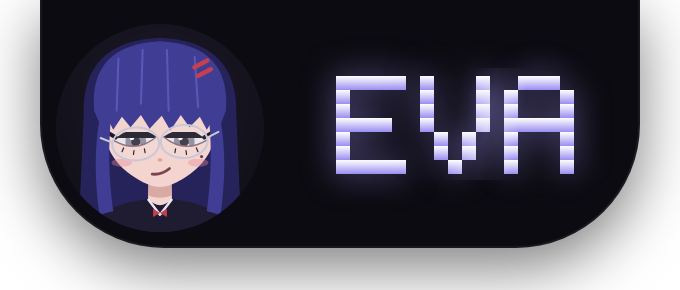
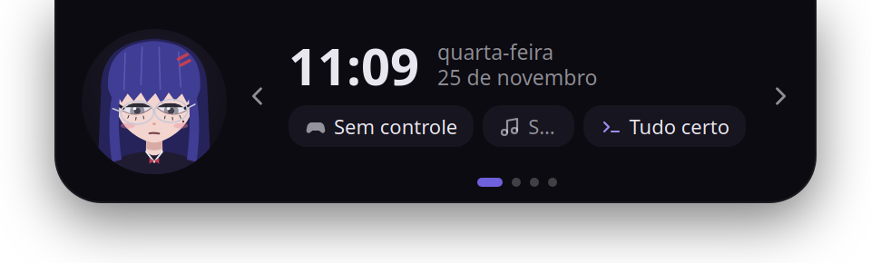
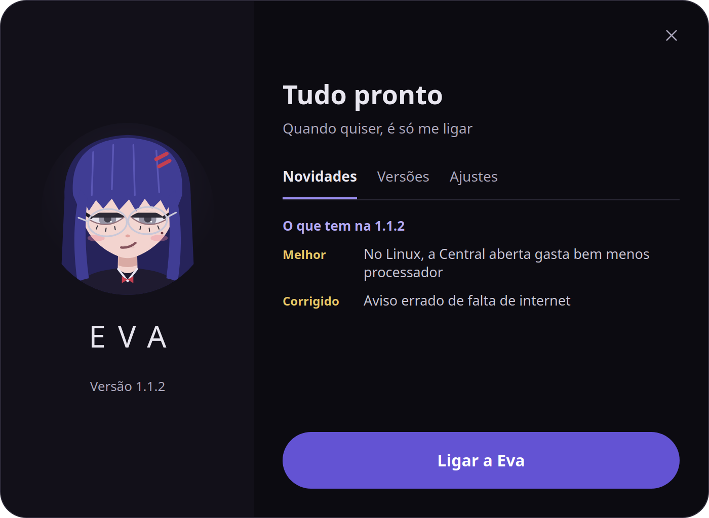

# My Eva

Uma companheira de mesa para **Windows** e **Linux**, em português. Ela fica no topo da tela mostrando a hora, a música e a bateria do controle, e some quando você não precisa.

Não é uma IA: é um programa leve que roda no seu PC, sem conta e sem telemetria.

<p align="center">
  
</p>

## O que ela faz

- **Geral:** relógio, data e um resumo do que está acontecendo.
- **Música:** título, artista, capa, progresso e botões. Funciona com Spotify, navegadores e outros players.
- **Controle:** bateria do DualShock 4, por USB ou Bluetooth.
- **Jeito próprio:** entrada animada, expressões, piscadas e olhos que seguem o mouse. Ela é um desenho original.

<p align="center">
  
</p>

Ela se esconde depois de 5 segundos e vira uma alcinha no topo da tela. Passe o mouse ali para trazê-la de volta.

## A Central

O programa abre na Central, onde você liga e desliga a Eva, vê as novidades e muda os ajustes.

<p align="center">
  
</p>

| Você faz | Acontece |
|---|---|
| **Ligar a Eva** | A Central fecha e a Eva aparece |
| Abrir o programa de novo | A Central volta, e a Eva continua ligada |
| **X** com a Eva ligada | Fecha só a Central |
| **Sair da Eva**, no ícone perto do relógio | A Eva some e a Central volta |
| **X** com a Eva desligada | Fecha o programa |

## Instalar

Baixe na página de [versões](https://github.com/bernardorocha675/My-Eva/releases).

**Windows:** abra o arquivo `my-eva_..._x64-setup.exe`. Instala só para o seu usuário, sem pedir administrador. O instalador não tem certificado da Microsoft, então o Windows pode mostrar um aviso na primeira vez.

**Linux:** baixe o arquivo `.AppImage`, deixe numa pasta fixa e permita a execução:

```bash
chmod +x my-eva_*.AppImage
```

Depois é só abrir. Feito e testado no Ubuntu com GNOME; em outros sistemas pode variar.

Na primeira vez, o programa passa a iniciar junto com o sistema, abrindo a Central. Dá para desligar em **Ajustes**.

## Internet e privacidade

A Eva funciona sem internet. Só a **Central** se conecta, e apenas ao GitHub:

- ao abrir, confere se existe versão nova;
- se existir, baixa e instala, mostrando o que mudou.

Nenhum dado seu é enviado. Como em qualquer download, o GitHub vê o endereço IP de quem baixa. Para não usar a internet, desligue **Atualizar sozinha** em **Ajustes**.

Toda atualização é assinada. Se a assinatura não conferir, o arquivo é descartado e a versão atual continua. Com a Eva ligada, nada é instalado.

## Diferenças entre os sistemas

| | Windows | Linux (GNOME) |
|---|---|---|
| Música | Controles de mídia do Windows | MPRIS |
| Capa da música | Sim | Só quando o player oferece a imagem no próprio PC; a do Spotify não aparece |
| Olhos seguindo o mouse | Em toda a tela | No Wayland, só com o mouse sobre a Eva |
| Mostrar e esconder | Tecla **INS** | No Wayland, por um atalho do GNOME (abaixo) |
| Brilho da alcinha | Contínuo | Parado, para gastar menos |

### Atalho no GNOME

Em **Configurações → Teclado → Atalhos personalizados**, crie um com a tecla que quiser e o comando abaixo, trocando pelo caminho do seu arquivo:

```bash
/caminho/para/my-eva.AppImage --alternar
```

## Compilar

Feita com [Tauri](https://tauri.app) (Rust, HTML, CSS e JavaScript). Precisa de Rust e Node 22.

No Ubuntu, instale antes:

```bash
sudo apt install build-essential pkg-config libwebkit2gtk-4.1-dev libayatana-appindicator3-dev librsvg2-dev libdbus-1-dev libxdo-dev libssl-dev
```

Depois, nos dois sistemas:

```bash
npm ci
```

```bash
npm run build
```

## Licença

Todos os direitos reservados. Você pode ver o código e usar os instaladores oficiais para fins pessoais; para o resto, veja a [LICENSE](LICENSE).
