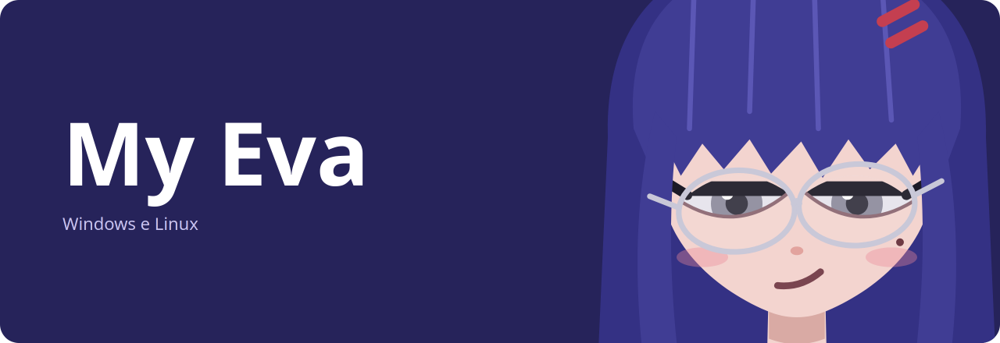

<p align="center">
  
</p>

Uma companheira de mesa para **Windows** e **Linux**, em português. Ela fica no topo da tela mostrando a hora, a música e a bateria do controle, e some quando você não precisa.

Não é uma IA: é um programa leve que roda no seu PC, sem conta e sem telemetria.

## Como funciona

<p align="center">
  
</p>

Passe o mouse na alcinha para ela voltar. Com o mouse longe, ela some em 5 segundos.

## O que ela faz

<p align="center">
  
</p>

## Instalar

Baixe na página de [versões](https://github.com/bernardorocha675/My-Eva/releases).

**Windows:** abra o arquivo `my-eva_..._x64-setup.exe`. Instala só para o seu usuário, sem pedir administrador. O Windows pode mostrar um aviso na primeira vez.

**Linux:** deixe o arquivo `.AppImage` numa pasta fixa e permita a execução:

```bash
chmod +x my-eva_*.AppImage
```

Na primeira vez, o programa passa a iniciar junto com o sistema, abrindo a Central. Dá para desligar em **Ajustes**.

## Internet e privacidade

Só a **Central** se conecta, e apenas ao GitHub, para conferir e baixar versões novas, sempre assinadas. Nenhum dado seu é enviado. Como em qualquer download, o GitHub vê o endereço IP. Para não usar a internet, desligue **Atualizar sozinha** em **Ajustes**.

## Licença

Todos os direitos reservados. Você pode ver o código e usar os instaladores oficiais para fins pessoais; para o resto, veja a [LICENSE](LICENSE).
